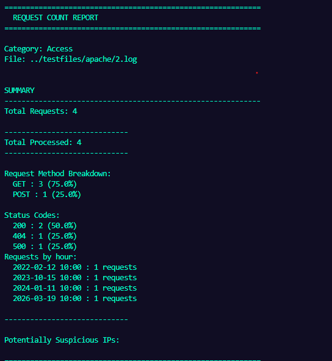
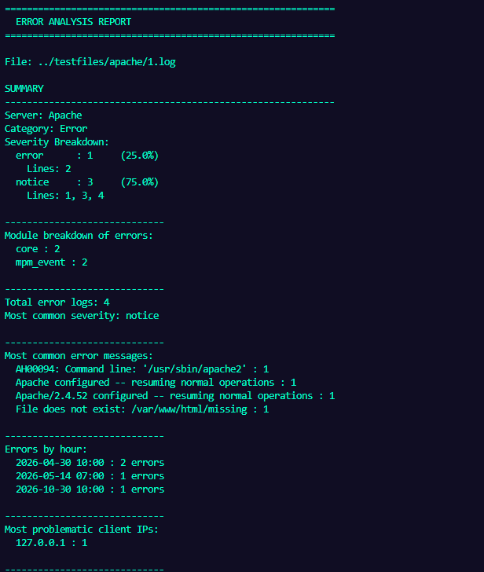

[](https://en.cppreference.com/w/cpp/17.html)
[](https://cmake.org/)
[](https://ubuntu.com/)
[](https://github.com/AaronthiccThai/LogAnalyser/blob/main/LICENSE)
[](https://github.com/AaronthiccThai/LogAnalyser/issues)
[](https://github.com/AaronthiccThai/LogAnalyser/actions/workflows/ci.yml)

# Log Analyser

## Overview

The Log Analyser is a C++ application designed to parse and analyse server log files. It currently supports Apache and Nginx access and error logs and generates structured reports such as request counts, error rates, and error severity distributions.


## Features

### Log Parsing
- Parses Apache and Nginx access and error logs
- Automatically identifies log types
- Extracts structured log entries from raw text
- Handles invalid or malformed lines safely

### Request Analysis
- Counts total requests
- Counts total errors
- Calculates success and error rates
- Provides overall traffic summary
- Future work would involve showcasing request method and its path

### Error Severity Analysis
- Categorises errors by severity (e.g. WARN, ERROR, CRITICAL)
- Tracks frequency of each severity level
- Calculates percentage distribution
- Future work would involve identifying the most severe error and its line number

---

## Project Structure

```text
.
├── Dockerfile
├── README.md
├── notes.txt
├── src
│   ├── analysers
│   │   ├── AnalyserEngine.cpp
│   │   ├── AnalyserEngine.h
│   │   ├── ErrorSeverityAnalyser.cpp
│   │   ├── ErrorSeverityAnalyser.h
│   │   ├── ILogAnalyser.h
│   │   ├── RequestCountAnalyser.cpp
│   │   └── RequestCountAnalyser.h
│   ├── main.cpp
│   ├── models
│   │   ├── AccessLogEntry.h
│   │   ├── ErrorLogEntry.h
│   │   ├── ILogEntry.h
│   │   ├── ILogParser.h
│   │   ├── apache
│   │   │   ├── ApacheAccessLogEntry.h
│   │   │   └── ApacheErrorLogEntry.h
│   │   └── nginx
│   │       ├── NginxAccessLogEntry.h
│   │       └── NginxErrorLogEntry.h
│   ├── parsers
│   │   ├── ParserEngine.cpp
│   │   ├── ParserEngine.h
│   │   ├── apache
│   │   │   ├── ApacheAccessLogParser.cpp
│   │   │   ├── ApacheAccessLogParser.h
│   │   │   ├── ApacheErrorLogParser.cpp
│   │   │   └── ApacheErrorLogParser.h
│   │   └── nginx
│   │       ├── NginxAccessLogParser.cpp
│   │       ├── NginxAccessLogParser.h
│   │       ├── NginxErrorLogParser.cpp
│   │       └── NginxErrorLogParser.h
│   └── utils
│       ├── DateTime.h
│       └── printHelp.h
│       └── toString.h
└── testfiles
    ├── apache
    │   ├── 1.log
    │   ├── 2.log
    │   ├── 3.log
    │   ├── 4.log
    │   ├── 5.log
    │   └── 6.log
    └── nginx
        ├── 1.log
        ├── 2.log
        └── 3.log
```
---

## Getting Started

### Prerequisites

- **C++ Compiler**: A C++17 compatible compiler (e.g., GCC 7+, Clang 5+, or MSVC 2017+).
- **CMake**: Version 3.10 or higher.
- **Docker** (optional): For containerised execution.

## Installation & Building


### Option 1: Build Natively (CMake)
1. **Clone the repository**:
   ```bash
   git clone https://github.com/AaronthiccThai/LogAnalyser.git
   cd LogAnalyser
   ```

2. **Build the project**:
   ```bash
   mkdir build && cd build
   cmake ..
   make
   cd ..
   ```

### Option 2: Running Via Docker
Ensure Docker is running in the background

1. **Clone the repository**:
   ```bash
   git clone https://github.com/AaronthiccThai/LogAnalyser.git
   cd LogAnalyser
2. **Build the Docker image**:
```docker build -t log-analyser .```


---

## Local Usage
Run the analyser by passing a log file followed by optional command-line flags:

```bash
./build/analyser [options] <log_file> 
```

### Examples

Analyse all logs:
```bash
./build/analyser testfiles/4.log
```

Run only severity analysis:
```bash
./build/analyser --severity testfiles/4.log 
```

Run only request analysis:
```bash
./build/analyser --requests testfiles/4.log 
```

Save report:
```bash
./build/analyser --save testfiles/4.log 
```

Show help:
```bash
./build/analyser --help
```

---

## Docker Usage

Run using Docker instead of local build:

### Build image
```bash
docker build -t log-analyser .
```

### Run analyser
```bash
docker run --rm log-analyser [options] <log_file> 
```

### Examples

Analyse logs:
```bash
docker run --rm log-analyser testfiles/4.log
```

Run severity analysis:
```bash
docker run --rm log-analyser --severity testfiles/4.log 
```

Save report (with volume mount):
```bash
docker run --rm -v $(pwd)/output:/app/output log-analyser --save testfiles/4.log 
```

Show help:
```bash
docker run --rm log-analyser --help
```

### Demo/Images
```bash
./analyser ../testfiles/apache/1.log
```



```bash
./analyser ../testfiles/apache/2.log
```
